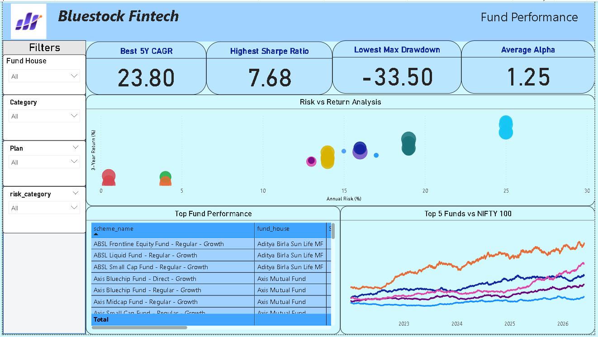
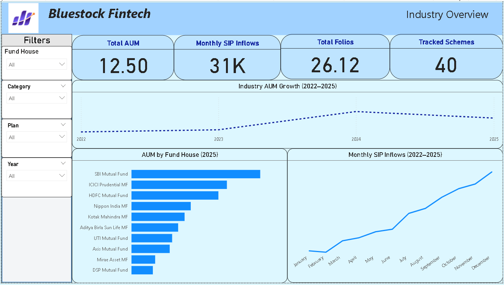
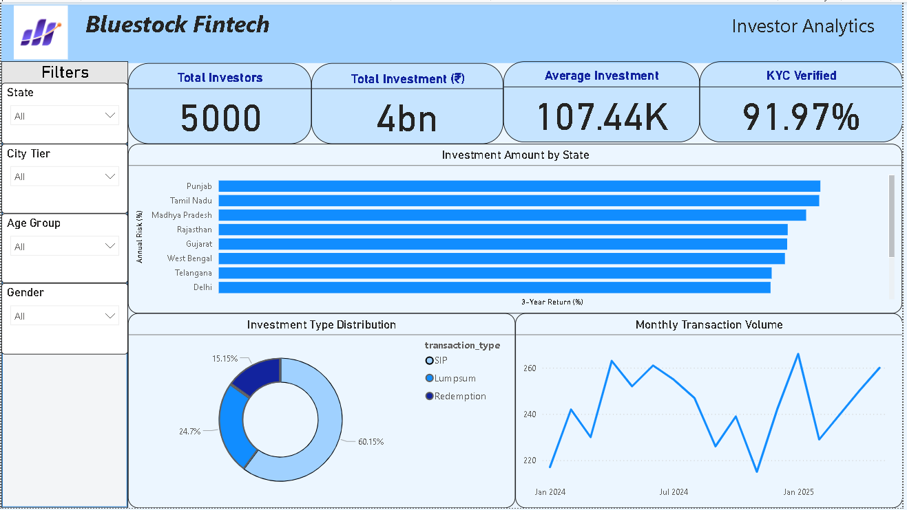

# Bluestock Fintech

**Financial Analytics & Data Intelligence**

This repository contains two financial analytics projects developed as part of the Bluestock Fintech Internship Program. Each project tackles a distinct domain — mutual fund industry analysis and Nifty 100 company fundamentals — using modern data engineering, analytics, and visualization stacks.

---

## Mutual Fund Analysis

**Purpose:** Analyze the Indian mutual fund industry, compare fund performance, understand investor behaviour, and evaluate investment risks.

### Implemented Features
- Analysis of **40 mutual fund schemes** across **10 fund houses** (2022–2026)
- Processing of **46K+ NAV records** and **32K+ investor transactions**
- Live NAV data fetching via `mfapi.in`
- Fund performance metrics: **CAGR (1/3/5Y), Sharpe, Sortino, Alpha, Beta, Maximum Drawdown**
- Advanced analytics: **VaR, CVaR, SIP continuity, cohort analysis, sector concentration (HHI)**
- SQLite database with star schema (dim/fact tables)
- 10 analytical SQL queries
- Power BI dashboard and generated analytical reports

### Dashboard Visualizations
| SIP & Market Trends | Fund Performance |
|:---:|:---:|
|  |  |

| Industry Overview | Investor Analytics |
|:---:|:---:|
|  |  |

> **Note:** A full interactive Power BI report (`bluestock_mf_dashboard.pbix`) is available in the project folder.

---

## Nifty 100 Financial Analysis

**Purpose:** A financial analysis platform for exploring Nifty 100 companies, comparing fundamentals, screening stocks, analysing sectors, and generating company reports.

### Implemented Features
- Financial database with **92 companies** and **10+ years** of financial data
- ETL pipeline with **16 data quality validation rules**
- Financial ratios, CAGR, cash-flow, and capital-allocation analytics
- **FastAPI backend** with **20+ endpoints** (companies, screener, sectors, peers, valuation, portfolio, documents, health)
- **Streamlit dashboard** with **8 pages** (Home, Company Profile, Screener, Peer Comparison, Financial Trends, Sector Analysis, Capital Allocation, Reports)
- Stock screener with **6 preset strategies** and custom filters
- Peer comparison across **11 peer groups** with percentile rankings and radar charts
- Company financial trends, sector analysis, and capital allocation assessment
- **K-means clustering** and company profiling
- Automated test suite (**795 tests passing**)
- PDF report generation (2-page tearsheets per company) and analyst documentation

### Visualizations
| Clustering Elbow Plot | Sample Tearsheet (PDF) |
|:---:|:---:|
| /reports/elbow_plot.png) | *2-page PDF tearsheets generated per company (KPIs, charts, balance sheet waterfall, pros/cons, capital allocation badge)* |

---

## Technology Stack

### Languages & Core


### Data & Analytics


### API & Dashboard


### Visualization & Reporting


### Testing & Quality


---

## Project Highlights

| Metric | Mutual Fund Analysis | Nifty 100 Analysis |
|--------|---------------------|-------------------|
| **Entities Analyzed** | 40 schemes, 10 fund houses | 92 Nifty 100 companies |
| **Time Coverage** | 2022–2026 (5 years) | 10+ years financial history |
| **Data Volume** | 46K+ NAV records, 32K+ transactions | 3,500+ ratio records, 12 financial tables |
| **Analytics** | CAGR, Sharpe, Alpha/Beta, VaR, HHI | Ratios, CAGR, Cash-flow, Capital allocation, Clustering |
| **Interface** | Power BI + Jupyter notebooks | FastAPI + Streamlit (8 pages) |
| **Screening** | Fund scorecard ranking | 6 presets + custom filters |
| **Peer Groups** | — | 11 sector-based groups |
| **Testing** | — | 795 tests passing |
| **Reports** | PDF, PPTX, CSV, SQL queries | PDF tearsheets, Excel, Analyst guide (15 pages) |

---

## Repository Structure

```
Bluestock-fintech/
├── mutual-fund-analysis/                    # Mutual Fund Industry Analytics
│   ├── data/                                # Raw (10 CSV + 6 live NAV) + processed
│   ├── notebooks/                           # 5 notebooks: ingestion → advanced analytics
│   ├── scripts/                             # 6 ETL/analysis Python scripts
│   ├── sql/                                 # Star schema + 10 analytical queries
│   ├── dashboard/                           # Power BI (.pbix) + 4 PNG exports
│   ├── reports/                             # CSV outputs, PDF report, PPTX
│   └── bluestock_mf.db                      # SQLite database
│
├── nifty100-financial-analysis(Bluestock-fintech)/  # Nifty 100 Platform
│   ├── src/
│   │   ├── analytics/                       # Ratios, CAGR, cashflow, capital allocation
│   │   ├── api/                             # FastAPI (8 routers, 20+ endpoints)
│   │   ├── dashboard/                       # Streamlit (8 pages)
│   │   ├── etl/                             # ETL pipeline + 16-rule validator
│   │   ├── nlp/                             # Pros/Cons generator
│   │   ├── reports/                         # PDF tearsheets, Excel reports
│   │   └── screener/                        # Screening engine, presets, peer charts
│   ├── db/nifty100.db                       # SQLite (5.8 MB, 12 tables)
│   ├── tests/                               # 795 tests (unit, api, analytics, performance)
│   ├── reports/tearsheets/                  # 92 company PDF tearsheets
│   └── docs/                                # Analyst guide, dataset profile
│
└── README.md                                # This file
```

---

## Quick Start

### Mutual Fund Analysis
```bash
cd mutual-fund-analysis
pip install -r requirements.txt
python scripts/live_nav_fetch.py          # Fetch live NAV from mfapi.in
python scripts/load_to_sqlite.py          # Create SQLite database
jupyter notebook notebooks/03_eda_analysis.ipynb
```

### Nifty 100 Platform
```bash
cd nifty100-financial-analysis\(Bluestock-fintech\)
python -m venv .venv && source .venv/bin/activate
pip install -r requirements.txt

# Load data (run once)
python -m src.etl.loader
python src/etl/validator.py

# Start services (two terminals)
# Terminal 1: API
uvicorn src.api.main:app --reload --port 8000
# Terminal 2: Dashboard
streamlit run src/dashboard/app.py

# Run tests
pytest tests/ -v
```

**API Base:** `http://localhost:8000/api/v1/`  
**Dashboard:** `http://localhost:8501`

---

## Acknowledgement

These projects were developed as part of the **Bluestock Fintech Internship Program**. They represent completed and accepted internship deliverables demonstrating end-to-end financial data engineering, analytics, and visualization capabilities.